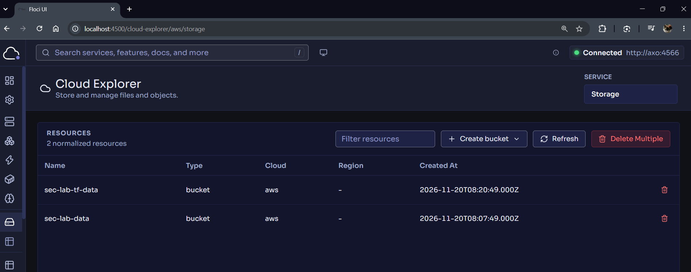
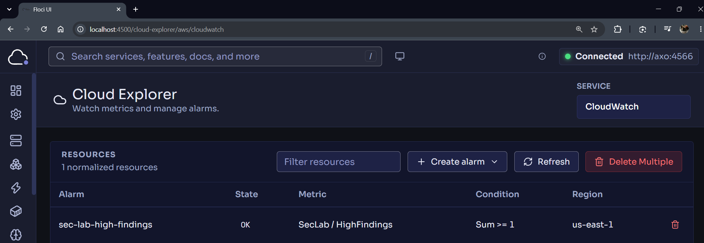
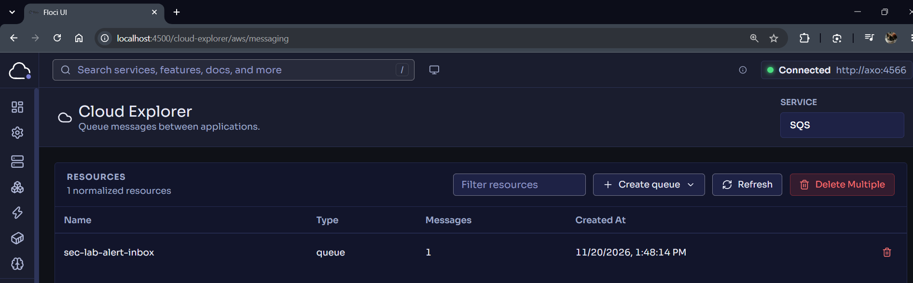
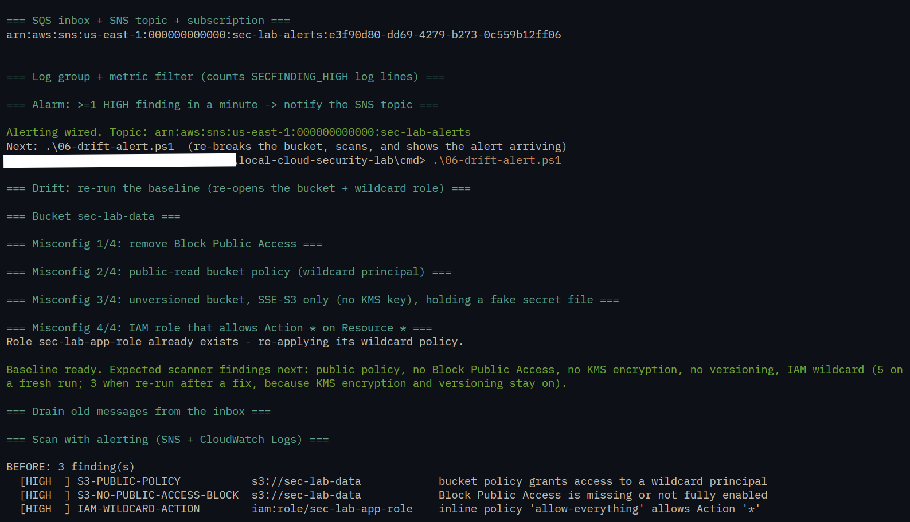
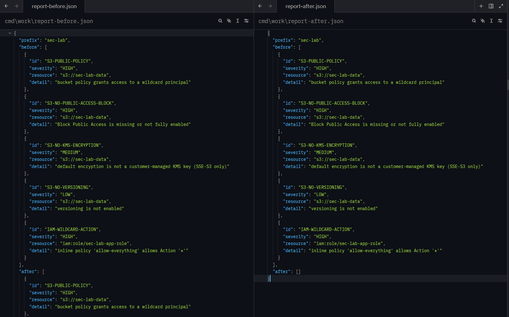
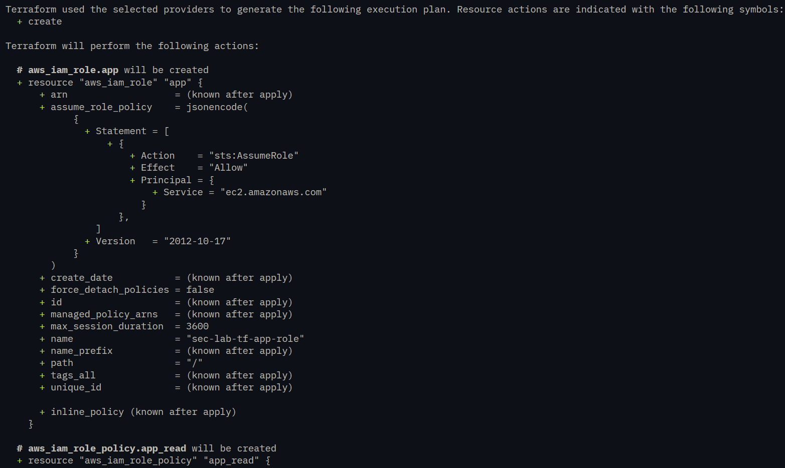

# Local Cloud Security Lab

A hands-on cloud security exercise that runs entirely on a local AWS emulator ([Floci](https://github.com/floci-io/floci)).
It builds a deliberately misconfigured environment, detects the problems with a small boto3 scanner, remediates them,
wires up alerting, and then rebuilds the same environment with Terraform and proves it clean.

No AWS account is used. Everything talks to `http://localhost:4566` with dummy credentials and fake data.

```
 baseline (misconfigured)        scanner                    alerting
 S3 + IAM role  ───────────►  find / --fix  ───────────►  CloudWatch Logs ► metric filter ► alarm
                                   │                                   └──► SNS ► SQS inbox
                                   ▼
                        Terraform (secure by default) ► scanner reports 0 findings
```

## Requirements

| Tool | Used for |
|---|---|
| Docker Desktop (running) | Floci container |
| AWS CLI v2 | all AWS calls |
| Python 3 | scanner (a `.venv` with `boto3` is created automatically) |
| Terraform | step 07 only |
| PowerShell 5.1+ | the scripts |

Tested on Windows 11, PowerShell 5.1, AWS CLI 2.39, Terraform 1.13 (AWS provider 6.73), Python 3.12 and
`floci/floci:latest` as of 2026-11-19. Steps 01-08 passed end to end.

## Quick start

```powershell
cd cmd
Set-ExecutionPolicy -Scope Process Bypass   # once per PowerShell window
.\01-start-floci.ps1
.\02-baseline.ps1
.\03-scan.ps1
.\04-fix.ps1
```

Then continue with 05-08 below. If port 4566 is already served by another Floci container, step 01 reuses it.

## Steps

| # | Script | What it does | Success looks like |
|---|---|---|---|
| 01 | `01-start-floci.ps1` | Starts Floci, or reuses whatever already serves port 4566 | Account `000000000000` printed |
| 02 | `02-baseline.ps1` | Creates a public bucket, no Block Public Access, SSE-S3 only, no versioning, and an IAM role with `Action: *` | "Baseline ready" |
| 03 | `03-scan.ps1` | Read-only scan, writes `work\report-before.json` | `BEFORE: 5 finding(s)` |
| 04 | `04-fix.ps1` | Creates a KMS key, remediates every finding, re-scans | `AFTER: 0 finding(s)` |
| 05 | `05-alerting.ps1` | Builds logs, metric filter, alarm, SNS topic and SQS inbox | "Alerting wired" |
| 06 | `06-drift-alert.ps1` | Re-opens the bucket, scans with alerting on, shows the alert | SNS message in the inbox, alarm `ALARM` |
| 07 | `07-terraform.ps1` | Builds the secure version with Terraform and scans it | `BEFORE: 0 finding(s)` |
| 08 | `08-cleanup.ps1` | Removes everything the lab created (`-StopFloci` also stops this folder's Floci) | no `sec-lab*` resources left |

The scanner can also be run directly:

```powershell
.venv\Scripts\python.exe scanner\scanner.py --prefix sec-lab [--fix --kms-key-id alias/sec-lab] [--report out.json]
```

It exits `1` when findings remain and `0` when clean, so it can gate a pipeline.

## Scanner rules

| ID | Severity | Rule | Remediation |
|---|---|---|---|
| `S3-PUBLIC-POLICY` | HIGH | Bucket policy `Allow` to `Principal: "*"` with no condition | Delete the policy |
| `S3-PUBLIC-ACL` | HIGH | ACL grants AllUsers or AuthenticatedUsers | Set ACL to private |
| `S3-NO-PUBLIC-ACCESS-BLOCK` | HIGH | Block Public Access missing or any of the 4 flags off | Enable all 4 |
| `S3-NO-KMS-ENCRYPTION` | MEDIUM | Default encryption is not `aws:kms` | Set KMS default encryption |
| `S3-NO-VERSIONING` | LOW | Versioning is not `Enabled` | Enable versioning |
| `IAM-WILDCARD-ACTION` | HIGH | Inline role policy `Allow` with `Action: "*"` | Delete that inline policy |
| `IAM-ADMIN-ATTACHED` | HIGH | `AdministratorAccess` attached to a role | Detach it |

Only buckets and roles whose names start with `--prefix` (default `sec-lab`) are touched, and an empty prefix is
refused, so other resources on a shared emulator are left alone.

## Alerting flow

The scanner writes one `SECFINDING_<SEVERITY> id=... resource=... detail=...` line per finding to CloudWatch Logs and
publishes a summary to SNS. A metric filter counts `SECFINDING_HIGH` lines, an alarm fires at `Sum >= 1` per 60 s and
notifies the same SNS topic, and the topic delivers to an SQS queue that stands in for email.

## Screenshots

Floci UI views captured during a run (all files in [docs/screenshots](docs/screenshots)).

| | |
|---|---|
|  Buckets after steps 02 and 07: `sec-lab-data` and `sec-lab-tf-data` |  Alarm `sec-lab-high-findings` on `SecLab/HighFindings` |
|  Alert message waiting in the SQS inbox |  Step 05/06 output: alerting wired, drift detected (3 findings) |
|  `report-before.json` (5 findings) next to `report-after.json` (`after: []`) |  Terraform plan for the secure rebuild |

## Project layout

```
cmd/
├── 01-…08-*.ps1        numbered steps, run in order
├── env.ps1             shared settings and helpers (dot-sourced by every script)
├── compose.yaml        Floci container, used only if nothing already serves :4566
├── scanner/scanner.py  the scanner and remediation logic
├── terraform/main.tf   the secure-by-default environment
├── docs/screenshots/   images used in this README
└── work/  .venv/       generated at run time, gitignored
```

## Limitations

**Emulator, not AWS**
- **No threat detection.** Floci's GuardDuty is management-plane only: no findings and no malware scanning. All alerts
  here come from this scanner. Real GuardDuty findings need a real AWS account.
- **Access enforcement is off by default** (`FLOCI_SERVICES_IAM_ENFORCEMENT_ENABLED`, `FLOCI_SERVICES_S3_ENFORCE_AUTH`).
  A "public" bucket is public in configuration only and the wildcard role is not enforced. The lab demonstrates
  misconfiguration detection and remediation, not exploitation.
- `GetBucketPolicyStatus` is not implemented, so the scanner parses policies itself.
- Floci is in-memory by default. Restarting the container wipes everything; re-run from step 02.
- Behaviour was checked against Floci's docs and the runs above, not against real AWS, and can differ.

**Scanner heuristics**
- Public-policy detection is simple: wildcard principal with no `Condition`. It ignores `NotPrincipal`, conditioned
  statements, access points and account-level Block Public Access.
- IAM coverage is role inline policies plus `AdministratorAccess`. No users, groups, customer-managed policies,
  `Resource: "*"` analysis, trust policies or permission boundaries.
- The IAM fix deletes the offending policy (deny by default) and does not write a replacement. Real use needs a
  least-privilege policy, ideally derived from access logs.
- New S3 buckets are SSE-S3 encrypted by default (as on AWS since 2023), so the encryption rule asks for a
  customer-managed KMS key. Existing objects are not re-encrypted by the fix.
- This is a teaching tool, not a substitute for Prowler, AWS Config or Security Hub.

**Alerting**
- SNS delivers to SQS rather than email. The alarm uses a 60 s period, so its state can read `OK` or
  `INSUFFICIENT_DATA` for a minute after step 06; re-run the `describe-alarms` command.
- Only HIGH findings trip the alarm.

**Terraform**
- Provider settings follow Floci's own compatibility tests (`skip_*`, path-style S3, endpoint overrides). To target real
  AWS, remove the `endpoints` block and fake keys, and pick a globally unique bucket name.
- State is local (`terraform/terraform.tfstate`); `08-cleanup.ps1` destroys it first.

## Troubleshooting

| Symptom | Fix |
|---|---|
| `Docker daemon is not running` | Start Docker Desktop and wait for "Engine running" |
| `Cannot reach Floci at http://localhost:4566` | Run `.\01-start-floci.ps1`; check `docker ps` |
| Script blocked by execution policy | `Set-ExecutionPolicy -Scope Process Bypass` |
| `aws` / `terraform` not found | Install it, then open a new PowerShell window |
| Everything missing after a restart | Floci is in-memory; re-run from `02-baseline.ps1` |
| Harmless "does not exist" errors in step 08 | Pieces that were never created or already removed |

## Cleanup

```powershell
.\08-cleanup.ps1              # remove lab resources, keep Floci running
.\08-cleanup.ps1 -StopFloci   # also stop the Floci started by this folder's compose.yaml
```

Delete `work/`, `.venv/` and `terraform/.terraform*` to reset local files.

## License

[MIT](LICENSE). Educational use only: run it against a local emulator, never against an AWS account you care about.
